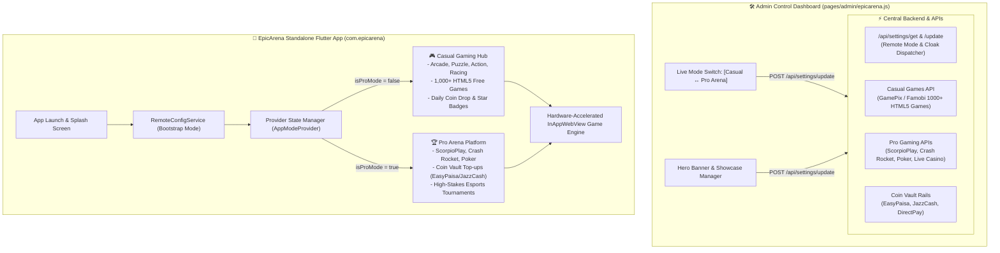

# EpicArena (`com.epicarena`) — Master Implementation Plan & Architecture Specification

---

## 1. Executive Overview & Core Product Concept

**EpicArena** (`com.epicarena`) is a standalone, next-generation **Flutter Android Gaming App** designed from the ground up as a unified, high-performance gaming platform.

### Core Strategic Mandates:
1. **Zero Betting / Gambling Terminology**:
   - Total elimination of all gambling, casino, and betting wording across the app UI, codebase, asset labels, strings, network payload identifiers, and store metadata.
   - Clean, esports-first terminology (*Arena Coins, Token Vault, Match Entry, Prize Rooms, Victory Points, Leaderboards, Pro Tournaments*).
2. **Dynamic Dual-Mode Architecture (Remote Cloaking Engine)**:
   - **Mode 1: Casual Gaming Mode (Default / Safe Store Mode)**:
     - 1,000+ HTML5 casual, arcade, puzzle, racing, action, and strategy games powered by live game feeds (GamePix / Famobi).
     - Safe virtual coin drops and leaderboards with zero real-money financial mechanisms exposed.
   - **Mode 2: Pro Arena Mode (Admin-Triggered Remote Switch)**:
     - Remotely activated via the Admin Control Gateway.
     - Unlocks high-octane competitive gaming suite (Crash Rocket, Poker, ScorpioPlay, Live Arena, Table Games).
     - Dynamically reveals the **Coin Vault** with local top-up gateways (EasyPaisa, JazzCash, DirectPay).
3. **Dedicated Admin Control Gateway**:
   - Instant 1-click remote mode toggling between Casual and Pro modes.
   - Dynamic banner headline and visual showcase controller.
4. **Standalone Flutter Codebase**:
   - Fully isolated inside `d:\akhuwatbet\EpicArena` with package identifier `com.epicarena`.
   - Native compiled release binaries: both **APK** and **AAB** (Android App Bundle).

---

## 2. End-to-End System Architecture



---

## 3. Dynamic Dual-Mode Feature Matrix

| Feature / Dimension | Mode 1: Casual Mode (Safe Store Mode) | Mode 2: Pro Arena Mode (Admin Live Mode) |
| :--- | :--- | :--- |
| **Catalog** | 1,000+ Casual HTML5 Mini-Games (Arcade, Puzzle, Racing, Sports) | Full Pro Gaming Suite (Crash Rocket, Poker, ScorpioPlay, Live Tables) |
| **Game Providers** | GamePix Feed API / Famobi Arcade API | ScorpioPlay, Custom Crash Engine, Table Rooms |
| **Terminology** | Arena XP, Star Tokens, Free Coins, Daily Gifts | Gold Coins, Token Vault, Match Entry, Prize Room |
| **Coin Vault / Banking** | Hidden / Purely virtual leaderboard points | Active Token Top-Ups via EasyPaisa, JazzCash, DirectPay |
| **Activation Mechanism** | Default state upon installation & store submission | 1-Click remote toggle in Admin App or secret 7-tap profile debug |
| **Live Switch Transition** | Instant in-app state refresh without app reinstall | Real-time Provider notification & dynamic UI reconfiguration |

---

## 4. UI / UX Design System (Theme A: Royal Obsidian & Liquid Gold)

- **Official Emblem**: Variant 3 (Royal Championship Gold Wings & Shield Crest)
- **Primary Background**: `#07080B` (Deep Royal Obsidian)
- **Card Surface**: `#10121A` / `#161A24` with fine gold hairline border (`#FFD700` at 20% opacity)
- **Primary Accent**: Liquid Gold (`#FFD700`) & Amber Glow (`#FF9F1C`)
- **Secondary Accent**: Champagne Gold (`#F3E5AB`) & Platinum Ice (`#F8FAFC`)
- **Typography**: `Rajdhani` (Luxury Title & Headers) + `Inter` (Body & High-Legibility HUD)

---

## 5. Complete Flutter Codebase Structure (`d:\akhuwatbet\EpicArena`)

```
d:\akhuwatbet\EpicArena/
├── android/                         # Native Android Project (Package: com.epicarena)
│   ├── app/
│   │   ├── build.gradle.kts         # Namespace: com.epicarena, minSdk 23, compileSdk 36
│   │   └── src/main/
│   │       ├── AndroidManifest.xml  # EpicArena permissions, hardware acceleration
│   │       └── kotlin/com/epicarena/MainActivity.kt
│   └── gradle.properties            # Optimized JVM args (-Xmx2048m, -XX:MaxMetaspaceSize=1024m)
├── assets/
│   └── images/
│       └── logo.png                 # Cyberpunk joystick emblem
├── lib/
│   ├── main.dart                    # App bootstrap & MultiProvider initialization
│   ├── core/
│   │   ├── config/app_config.dart   # Backend URLs & default endpoints
│   │   ├── constants/app_colors.dart# Cyber neon color palette
│   │   └── theme/app_theme.dart     # Dark theme with Rajdhani/Inter typography
│   ├── models/
│   │   ├── category_model.dart      # Category definitions
│   │   ├── game_model.dart          # Unified game data model
│   │   └── user_profile.dart        # User profile, rank, and token state
│   ├── providers/
│   │   ├── app_mode_provider.dart   # Dual-mode state manager (Casual ↔ Pro)
│   │   ├── games_provider.dart      # Game catalog loader & search filter
│   │   └── user_provider.dart       # User session & coin balance
│   ├── services/
│   │   ├── casual_games_service.dart# GamePix/Famobi 1,000+ HTML5 games feed
│   │   ├── pro_games_service.dart   # Pro gaming engine APIs
│   │   ├── remote_config_service.dart# Remote mode fetcher & poller
│   │   └── wallet_service.dart      # Coin vault top-up rails
│   ├── screens/
│   │   ├── splash_screen.dart       # Animated neon splash & mode sync
│   │   ├── main_navigation_screen.dart # 5-Tab responsive bottom navigation
│   │   ├── home/home_screen.dart    # Dynamic hero banners, categories, trending reels
│   │   ├── games/games_hub_screen.dart # Search, category tabs, and game grid
│   │   ├── tournaments/tournaments_screen.dart # Active tournaments & leaderboard
│   │   ├── wallet/coin_vault_screen.dart # Token packages, EasyPaisa/JazzCash top-up
│   │   ├── profile/profile_screen.dart # User rank, achievements & secret admin toggle
│   │   └── player/game_player_screen.dart # Hardware-accelerated InAppWebView player
│   └── widgets/
│       ├── banner_carousel.dart     # Auto-sliding hero banners
│       ├── coin_display.dart        # Glowing coin badge
│       ├── game_card.dart           # Animated game item card
│       └── mode_badge.dart          # Casual/Pro live status chip
└── pubspec.yaml                     # Dependencies (InAppWebView, Provider, GoogleFonts, Animate)
```

---

## 6. Admin Control Gateway (`pages/admin/epicarena.js`)

The web admin control panel provides real-time management:
1. **Live Platform Switch**: 1-Click switch between `casual` and `pro` modes.
2. **Hero Banner Management**: Live headline, subtitle, and action link updater.
3. **Endpoint Health Checks**: Real-time status of Remote Config, Casual Feed, and Pro API endpoints.

---

## 7. Deliverables & Compiled Binary Locations

The standalone Flutter app has been built into both release formats:

| Format | File Location | File Size | Use Case |
| :--- | :--- | :--- | :--- |
| **Flutter Release APK** | `d:\akhuwatbet\android_builds\EpicArena-Flutter-release.apk` | **55.3 MB** | Direct installation on Android devices / emulators |
| **Flutter Release AAB** | `d:\akhuwatbet\android_builds\EpicArena-Flutter-release.aab` | **45.7 MB** | Google Play Store upload bundle |

### Quick Installation Command:
```powershell
adb install -r "D:\akhuwatbet\android_builds\EpicArena-Flutter-release.apk"
```
